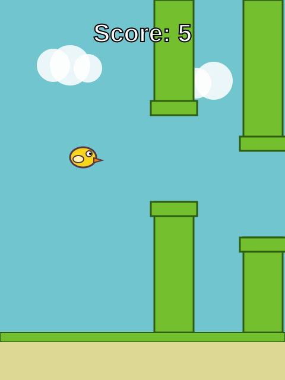
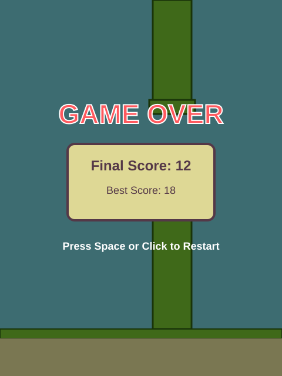

# YMH219-FlappyBird

## 1. Proje Adı ve Kısa Açıklama
**YMH219-FlappyBird**, YMH219 dersi kapsamında C# 12 ve .NET 8.0 Windows Forms kullanılarak nesne yönelimli programlama (OOP) ilkeleriyle geliştirilmiş klasik Flappy Bird masaüstü oyunudur.

## 2. Kullanılan Teknoloji / NuGet Paketleri
- **Programlama Dili:** C# 12
- **Platform / Çerçeve:** .NET 8.0 Windows Forms
- **Grafik Kütüphanesi:** System.Drawing / GDI+
- **NuGet Paketleri:** Harici bir NuGet paketi kullanılmamıştır; yalnızca .NET 8.0 Windows Forms ve System.Drawing / GDI+ yerleşik bileşenleri kullanılmıştır.

## 3. Kurulum ve Çalıştırma Adımları
### Visual Studio 2022 ile Çalıştırma
1. Depoyu bilgisayarınıza klonlayın ve proje klasörüne girin.
2. `FlappyBird.sln` dosyasını Visual Studio 2022 ile açın.
3. Projeyi derleyip çalıştırmak için `Ctrl+F5` tuşlarına basın.

### .NET CLI ile Çalıştırma
Depo kök dizininde aşağıdaki komutu çalıştırın:
`dotnet run --project FlappyBird/FlappyBird.csproj`

## 4. Uygulamanın Temel Özellikleri
- **Nesne Yönelimli Mimari:**
  - `GameEntity`: Tüm oyun varlıkları için temel soyut sınıf.
  - `Bird`: Kuşun konum, hız, yerçekimi ve zıplama fiziğini yöneten sınıf.
  - `PipePair`: Üst ve alt boru engellerini ve geçiş kontrolünü yöneten sınıf.
  - `GameEngine`: Oyun döngüsünü, boru üretimini, çarpışma algılamayı ve skor takibini yöneten motor sınıfı.
  - `MainForm`: Windows Forms arayüzü, GDI+ çizimi ve kullanıcı girişlerini işleyen ana form.
- **Klavye ve Fare Kontrolleri:** Klavye (`Space`, `W`, `Yukarı Ok`) veya fare sol tıklaması ile kuşu zıplatma.
- **Çarpışma Algılama:** Borulara, zemine veya üst sınıra çarpıldığında oyunun sona ermesi.
- **Skor Takibi:** Geçilen her boru çifti için anlık skor artışı ve en yüksek skor (High Score) kaydı.
- **Yeniden Başlatma (Restart):** Oyun bittiğinde klavye veya fare ile oyunu hızlıca yeniden başlatabilme.

## 5. Ekran Görüntüleri
### Oyun İçi Görüntü (Gameplay)

### Oyun Bitti Görüntüsü (Game Over)

## 6. Bilinen Sınırlamalar / Geliştirme Notları
- Uygulama Windows Forms ve GDI+ kullandığı için yalnızca Windows işletim sistemlerinde çalışmaktadır.
- Harici görsel veya ses dosyaları yerine GDI+ ile programatik vektör çizimler tercih edilmiştir.
- Pencere boyutu sabit olarak tasarlanmıştır; farklı çözünürlükler için dinamik ölçekleme bulunmamaktadır.

## 7. Öğrencinin Adı-Soyadı ve Öğrenci Numarası
- **Adı Soyadı:** Ahmed Al Hamed
- **Öğrenci Numarası:** 225541606
